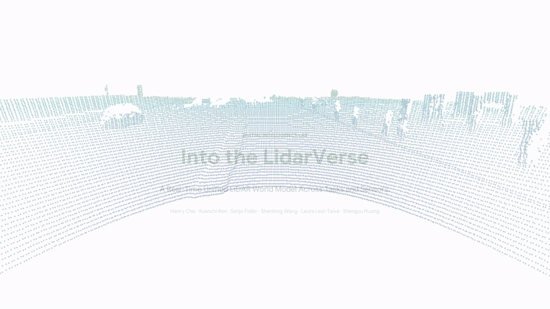

<!--
SPDX-FileCopyrightText: Copyright (c) 2026 NVIDIA CORPORATION & AFFILIATES. All rights reserved.
SPDX-License-Identifier: Apache-2.0
-->

<h1 align="center">Into the LidarVerse:<br>A Real-Time Unified LiDAR World Model Across Tasks and Sensors</h1>

<p align="center"><strong>
  Henry Che<sup>1,2</sup> &ensp;
  Xuanchi Ren<sup>1</sup> &ensp;
  Sanja Fidler<sup>1</sup> &ensp;
  Shenlong Wang<sup>2</sup> &ensp;
  Laura Leal-Taix&eacute;<sup>1</sup> &ensp;
  Shengyu Huang<sup>1</sup>
</strong></p>
<p align="center"><sup>1</sup>NVIDIA &nbsp;&nbsp; <sup>2</sup>University of Illinois Urbana-Champaign</p>

<p align="center">
  <a href="https://research.nvidia.com/labs/sil/projects/lidarverse/"></a>
  &nbsp;
  <a href="https://arxiv.org/abs/2610.19201"></a>
  &nbsp;
  <a href="https://huggingface.co/nvidia/lidarverse"></a>
  &nbsp;
  <a href="https://huggingface.co/datasets/nvidia/Cosmos-Transfer-LidarGen-Example"></a>
  &nbsp;
  <a href="#quickstart"></a>
</p>

<a href="https://github.com/nv-tlabs/lidarverse/raw/refs/heads/main/docs/media/teaser.mp4">
  
</a>

[Quickstart](#quickstart) | [Fine-tuning](docs/finetuning.md) | [Model card](model-cards/lidarverse.md)

## Abstract

**LidarVerse** is a real-time unified LiDAR world model for generation,
point-cloud forecasting, and generalizable resimulation. It combines the
flexibility of generative modeling with reconstruction-grounded simulation
without per-scene optimization. An attention-based tokenizer maps different
LiDAR scanning patterns into a shared latent space, while flexible conditioning
on observed LiDAR, HDMaps, and accumulated geometry enables one model to perform
all three tasks. Self-forcing distillation produces a four-step causal model;
a rolling temporal K/V cache and a persistent spatial cache support long-horizon
generation at 11 FPS on a single H100 GPU. LidarVerse achieves state-of-the-art
performance on most reported metrics across the three evaluation protocols.
The framework also supports cross-sensor generation with intensity, and its
tokenizer generalizes to an unseen scanning pattern.

## Setup

### Dependencies

Linux, Python 3.10, and an NVIDIA GPU with CUDA 12.6.

```bash
git clone https://github.com/nv-tlabs/LidarVerse.git
cd LidarVerse

sudo apt-get update
sudo apt-get install -y ffmpeg
python -m pip install torch==2.7.0 torchvision==0.22.0 \
  --index-url https://download.pytorch.org/whl/cu126
python -m pip install -r requirements.txt
```

For diffusion inference, also install the
[diffusion runtime extensions](docs/setup.md#runtime-dependencies),
or use an existing compatible training container.

### Checkpoints

Download the tokenizer and Stage 1/2/3 EMA packages from
[nvidia/lidarverse](https://huggingface.co/nvidia/lidarverse).
Authenticate with an account that has accepted any required access terms.

```bash
huggingface-cli login
python scripts/download_checkpoints.py
```

The downloader checks that all four packages are present:

```text
checkpoints/
  lidarverse-tokenizer-pai/  # ckpt.pt, latent_stats.pt, config.json
  lidarverse-bidir-pai/      # ema_model.pt, config.json
  lidarverse-causal-pai/     # ema_model.pt, config.json
  lidarverse-sfdmd-pai/      # ema_model.pt, config.json
  pai_manifest.json
```

These packages are range-only NVIDIA PAI models, not the paper's
cross-sensor or intensity checkpoints. Stage 2 is also used for fine-tuning.

## Quickstart

Run the commands below from the repository root. Accept the terms for the
[NVIDIA example dataset](https://huggingface.co/datasets/nvidia/Cosmos-Transfer-LidarGen-Example)
before downloading samples.
The dataset's `main` revision includes aligned HDMaps, actor boxes, and
raw vector maps for all five quickstart clips. The diffusion quickstarts
download and prepare these automatically.

### Tokenizer Reconstruction

```bash
CUDA_VISIBLE_DEVICES=0 \
bash scripts/getting_started.sh
```

This downloads one clip and saves an **Input | Reconstruction** video to
`outputs/tokenizer_quick_start_pai40k/reconstruction.mp4`, with a white background and ego-centric view.
The tokenizer uses 128x1024 inputs, a 2.5--100 m range, and FP32 encoding/decoding.
Use `PAI_SOURCE_ROOT=/path/to/lidar_dataset_release` for an existing download,
or `CHUNK_FRAMES=9` to reduce memory use.

### Stage 1: Bidirectional Generation

Uses **35 SDE steps** and **CFG 3**. The quickstart prepares
**sample 1** (`sample_001.npz`, the second official clip), including HDMaps and actor annotations, then
runs HDMap-conditioned generation, forecasting, and resimulation.

```bash
CUDA_VISIBLE_DEVICES=0 STAGE=1 MODE=all NUM_SAMPLES=1 \
NUM_STEPS=35 SAMPLER=sde SDE_ETA=1 GUIDANCE=3 SEED=0 \
OUTPUT_ROOT="outputs/pai_bidir_quickstart" \
bash scripts/diffusion/getting_started.sh
```

### Stage 3: Self-Forcing Generation

Uses the SF-DMD EMA in `checkpoints/lidarverse-sfdmd-pai/` with **4 SDE steps**, **CFG 1**,
four-frame blocks, and a nine-frame K/V cache including the sink frame.
The tokenizer runs in FP32 for both encoding and decoding; the spatial cache uses 0.10 m voxels.

```bash
CUDA_VISIBLE_DEVICES=0 STAGE=3 MODE=all NUM_SAMPLES=1 \
NUM_STEPS=4 SAMPLER=sde SDE_ETA=1 GUIDANCE=1 SEED=0 \
OUTPUT_ROOT="outputs/pai_sfdmd_quickstart" \
bash scripts/diffusion/getting_started.sh
```

## Fine-Tuning

See [docs/finetuning.md](docs/finetuning.md) for strict post-training from the
released weights and training commands.

## Acknowledgments

We thank the authors of [R2Flow](https://github.com/kazuto1011/r2flow),
[ArtiFixer](https://github.com/nv-tlabs/ArtiFixer),
[Cosmos-Drive-Dreams](https://github.com/nv-tlabs/Cosmos-Drive-Dreams), and
[Cosmos](https://github.com/NVIDIA/cosmos) for sharing their code
and models, which this project builds upon.

We thank Aditya Mahajan for his valuable help in open-sourcing the project.

## Citation

If you find LidarVerse useful for your research, please cite:

```bibtex
@misc{che2026lidarverse,
  title = {Into the {LidarVerse}: A Real-Time Unified {LiDAR} World Model Across Tasks and Sensors},
  author = {Henry Che and Xuanchi Ren and Sanja Fidler and Shenlong Wang and Laura Leal-Taix{\'e} and Shengyu Huang},
  year = {2026},
  eprint = {2610.19201},
  archivePrefix = {arXiv},
  primaryClass = {cs.CV}
}
```
